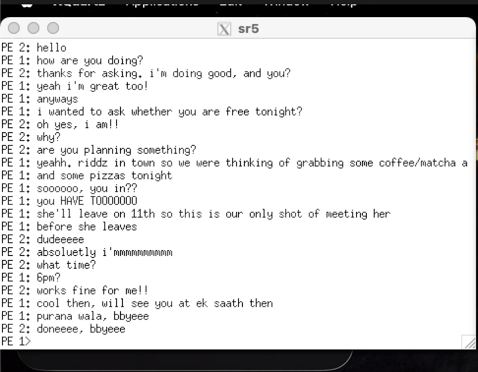
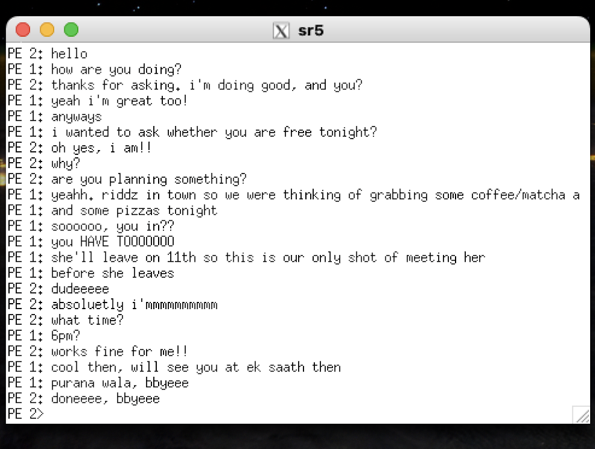

# MPI Chat

This project is a small C chat program built with the Message Passing Interface
(MPI). It starts exactly two MPI processes, called PE 1 and PE 2 in the
interface. Each process has a chat history above a fixed input line at the
bottom of its terminal. Messages appear in the sender's history and in the
other process's history as soon as they are sent and received.

## Project scope

The assignment describes System 1 and System 2 as separate computers connected
over a network. For development and testing, this implementation runs two MPI
processes on one computer. PE 1 and PE 2 represent the two participants in the
chat; they do not represent two physical devices in the local test. This
demonstrates MPI message exchange between processes, but does not by itself
verify a run across two networked computers.

## How the program works

MPI starts two copies of the program. Each copy asks MPI for its rank and uses
the other rank as its peer. Rank 0 is shown as PE 1; rank 1 is shown as PE 2.

While the program is running, each process checks both its keyboard and its
MPI connection. This lets it display an incoming message while its user is
still composing a reply. When a user presses Enter, the program sends the line
with `MPI_Isend` and adds it to that user's local chat history. The receiving
process checks for messages with `MPI_Iprobe`, receives them with `MPI_Recv`,
and adds them to its history. Typing `/quit` sends a shutdown message so both
processes can leave the chat cleanly.

The terminal interface uses POSIX terminal features to read individual
keystrokes and redraw the history and input line. The current implementation
is intended for macOS and Linux terminals. It requires a separate interactive
terminal attached to each process.

## Requirements

- MPICH installed, including `mpicc` and `mpiexec`
- A macOS or Linux environment with a POSIX-compatible terminal
- `xterm` for the two-window local examples below
- XQuartz on macOS, to provide X11 windows for `xterm`

## Build

Run this in the project directory on each computer where the program will run:

```sh
mpicc -Wall -Wextra -o sr2 main.c
```

If the computers use different operating systems or processor architectures,
build the executable separately on each one. Do not assume that a binary
built for one operating system will run on another.

## Run two processes on one computer

The two MPI processes can run on one computer for testing. Each needs its own
terminal window so each process has its own keyboard input.

### Linux

If `xterm` is installed and available on your `PATH`, run:

```sh
mpiexec -n 2 xterm -e ./sr2
```

### macOS

Install and start XQuartz, and make sure `echo "$DISPLAY"` prints a value in
the terminal where you will launch MPI. Then run:

```sh
mpiexec -n 2 /opt/X11/bin/xterm -e ./sr2
```

The `/opt/X11/bin` path is specific to a typical XQuartz installation on
macOS. It is not a general MPICH path. If XQuartz was just installed and
`DISPLAY` is empty, log out of macOS and back in, then check `DISPLAY` again.

## Use the chat

- Type a message on the input line at the bottom of either window.
- Press Enter to send it. It appears in both processes' chat histories.
- Use Backspace to edit the line before sending.
- Type `/quit` and press Enter to close the chat on both processes.

## Example session

Suppose PE 1 sends `Hello, PE 2!`, then PE 2 replies `Hi, PE 1!`. Both
terminals show the same chat history. The input line remains at the bottom of
each terminal and belongs to that PE:

**PE 1 terminal**

```text
PE 1: Hello, PE 2!
PE 2: Hi, PE 1!
PE 1> How are you?
```

**PE 2 terminal**

```text
PE 1: Hello, PE 2!
PE 2: Hi, PE 1!
PE 2> I'm doing well, thanks!
```

The text after each `PE …>` prompt is what that process is currently
composing. It enters the shared chat history after the sender presses Enter.

## Screenshots of test results

### terminal of process 1



### terminal of process 2


## Run MPI processes across two computers

To distribute the two MPI processes across two computers, install compatible
MPICH versions on both and configure the launching computer to start processes
on the other computer, usually through SSH. Verify SSH access first:

```sh
ssh user@system2 hostname
```

Replace `user@system2` with the second computer's account and network
hostname. Create a file named `hosts` in the launch directory with one host per
line:

```text
system1
system2
```

Build `sr2` on both computers, or place each computer's compatible executable
at a path accessible to the launcher. Then start two MPI processes from
System 1:

```sh
mpiexec -f hosts -n 2 /path/to/sr2
```

The host file tells MPICH Hydra where to start the MPI processes. See the
[MPICH Hydra process manager guide](https://github.com/pmodels/mpich/blob/main/doc/wiki/how_to/Using_the_Hydra_Process_Manager.md)
for host-file and launcher details.

### Important: terminal input on two computers

Starting one MPI process on each computer does not automatically connect each
process to the keyboard and screen of the person sitting at that computer.
The `mpiexec` command above distributes the processes, but the interactive
chat also needs a terminal attached to each process. Some launch setups provide
per-process terminals; a standard MPI launch often does not.

MPICH Hydra can launch `xterm` windows with X11 forwarding, for example:

```sh
mpiexec -enable-x -f hosts -n 2 xterm -e /path/to/sr2
```

This requires `xterm` on the hosts and X11 forwarding configured for SSH. The
forwarded windows are displayed on the X server of the launching computer; this
does not automatically create a terminal on each remote computer's own
desktop. For two people to type from their respective computers, configure a
per-process terminal arrangement that connects each rank to its user's local
keyboard and display.
